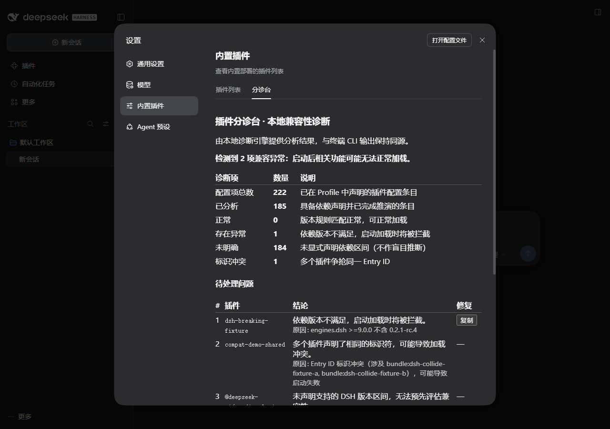

# dsh-triage

**DSH 插件：装得上，不等于跑得对。**

升级前跑一条命令，看清你这套插件会坏哪几个；插件装完就消失时，逐行指出被哪条准入规则拦住。

[](https://www.npmjs.com/package/dsh-triage)
[](LICENSE)
[](https://nodejs.org)
[](scripts/gate.mjs)

[English](#english) | [安全模型](docs/SECURITY.md) | [贡献指南](CONTRIBUTING.md) | [交接说明](docs/HANDOFF.md)

```bash
npm i -g dsh-triage
dsh-triage upgrade --to next --card
```

一张卡片，按**你本地已装的这套插件**推演：升到下一个 DSH 版本，哪些会被准入规则摘掉、哪些判不了、哪些会变好。每个被拦的条目都带原因和可直接执行的修复命令。

## 三个场景

| 你遇到的问题 | 一条命令 | 它给出什么 |
|---|---|---|
| 升级 dsh 前，想知道会坏几个插件 | `dsh-triage upgrade --to next --card` | 四桶清单：会被拒 / 判不了 / 会变好 / 像没事 |
| 插件装完在界面里消失了，日志没报错 | `dsh-triage why` | 逐行说明：哪一行、被哪条准入规则、缺哪个声明 |
| 想装新插件，又怕和现有的撞车 | `dsh-triage check <包名>` | 装前判定：会被拒还是能进，冲突在哪 |

装进 DSH 设置页也是同一条数据：

```bash
dsh plugin --profile web add dsh-triage
```

设置页 →「分诊台」，一屏结论 + 最多 3 条要看的地方 + 修复命令。



**默认只读。** `status` / `why` / `audit` / `upgrade` / `check` / `serve` 都不写盘。只有你显式加 `--apply` 的 `fix` / `rescue` 会改配置：`fix --apply` 只动 `<profile>/compatibility.json`，`rescue --apply` 只动 `dsh.profile.bundles`，都先备份、写 journal，`--undo` 逐字节还原。

<details>
<summary><b>看一张真实的升级卡片</b>（沙盒 profile，不是你的机器）</summary>

<!-- upgrade-card: data/results/upgrade-card-2026-11-11T12-30-00.000Z.json -->
```console
$ dsh-triage upgrade --to latest
# 升级日 · 0.2.2-rc.1

**upstream：192 个单元（2 bundle + 190 行）升到 0.2.2-rc.1 → 119 会被拒 · 73 判不了 · 0 会变好 · 0 像没事**

> profile `upstream`（live）· 当前 0.2.1-rc.4 · 目标比当前新
> 判的是**声明层**：只看「声明区间 vs 目标运行时」，不是运行期实测。

| 桶 | 数量 | 意思 |
|---|---|---|
| `would-be-denied` | 119 | 升上去会被摘掉 —— 目标版本的 admission 会拒绝这一行/包 |
| `cannot-tell` | 73 | 判不了 —— 声明不足或目标还没发布，证据不够 |
| `improved` | 0 | 今天被拒、目标放行 —— 今天是坏的，目标版本会放行它 |
| `likely-fine` | 0 | 声明上不冲突 —— 不等于升级后能跑，只表示没有声明冲突 |
```
<!-- /upgrade-card -->

数据来自仓内沙盒 profile `sandbox/upstream/0.2.1-rc.4`，目标 `0.2.2-rc.1`，**不是你的机器**；你本机实际装的配置才是输入。
复算：`node scripts/record_upgrade_card.mjs --stamp 2026-11-11T12:30:00.000Z --to latest`。
卡片不承诺「升级后一定能跑」：`improved` 只表示**目标版本会放行**，放行不等于运行期实测通过。

</details>

<details>
<summary><b>它凭什么判断</b>（证据与边界，全部可复算）</summary>

所有结论在本地计算，并绑定证据等级（`declared` / `scanned` / `measured-local` / `measured-registry` / `inferred`）；信息不足时直接给 `unknown` 并列出缺什么，不做无证据推测。

| 它证明了什么 | 证据 |
|---|---|
| 准入语义与上游逐条对等（不是「我们觉得」） | `data/gold/admission-cases.json`（27 条人工签署金标） |
| 真实故障上 9/10 给出可行动归因 | `data/results/d1-2026-10-26T12-00-00.000Z.json` |
| 隔离沙盒里真装、真启动、真取页面 | `packages/probe/`、`data/results/d2-*` |
| 发布包在干净环境装得上、四条命令都跑得通 | `data/results/publish-*.json`、`data/results/usability-*.json` |
| 声明区间 `>=0.2.0-rc.1 <0.3.0-0` 对本机 `0.2.2-rc.3` 实测 **satisfied** | `data/results/audit-2026-11-13T18-25-00.000Z.json` |
| 上游 Q&A 1545 条里，声明层能答 74 条（4.8%）；`not-relevant` 950 条是**分类器没读到信号**，不等于「与我们无关」 | `data/results/question-coverage-2026-11-02T09-57-53-229Z.json` |
| 995 个测试 + 10 道零依赖门禁（含负对照） | `pnpm run verify`、`node scripts/gate.mjs --mutate` |

**没证明什么**：它不是安全审计，不给任何「可以放心运行」的背书；它判的是声明层与已装集合，**不是**把所有插件都跑一遍的全网兼容矩阵；`unknown` 就是未知，不是「大概没事」。

### 上游问题覆盖率（完整表）

<!-- question-coverage: data/results/question-coverage-2026-11-02T09-57-53-229Z.json -->
**样本**：`deepseek-ai/deepseek-harness` 的 **Q&A 全量 1545 条**（2026-08-13 → 2026-11-02，截止 `#11857`），目标运行时 `0.2.1-rc.5`。**能给出声明层判定：74/1545 = 4.8%（Wilson 95% 3.8–6.0%）**。

| tier | 条数 | 占 Q&A | 意思 |
|---|---:|---:|---|
| `names-a-denial` | 47 | 3.0% | 能点名「这个包会被拒」并给出区间 |
| `rules-out-declaration` | 27 | 1.7% | 能排除声明层（「不是版本区间的问题」） |
| `declares-nothing` | 89 | 5.8% | 只能说明「没声明」——不算兼容，也不算被拒 |
| `upstream-only` | 164 | 10.6% | 只涉及未点名的上游包（npm tag 常年过期），不进头条 |
| `probe-unreadable` | 90 | 5.8% | 名字在 npm 上不存在（404）——名字抽取的问题，不是 registry 读不到 |
| `needs-their-profile` | 178 | 11.5% | 相关层，但没有可探针的包名 |
| `not-relevant` | 950 | 61.5% | 分类器没读到任何信号——**不等于「与我们无关」** |

**上下文（不是头条）**：有层信号的 **595** 条里 **74/595 = 12.4%（Wilson 10.0–15.3%）**；再摘掉读不到的 90 条，是 **74/505 = 14.7%（11.8–18.0%）**。**General 全量 5786 条**另算：**411/5786 = 7.1%（6.5–7.8%）**，投影快照，只作对照，**不与 Q&A 合并**。

**边界**：只对这个样本成立；判的是**已发布 manifest** 对 `0.2.1-rc.5`，**不是你的机器**；分类器只读文本，agent 复核 20 条一致 **9/20**，HUMAN 抽查 **5/5**；未点名的上游包不进头条；`probe-unreadable` 多数是 npm 上没这个名字（404），不是 npm 挂了。**R88 复核（`data/results/extension-candidates-2026-11-05T16-50-00.000Z.json`）**：那 950 条在产物里**全是 `layer=unknown`、零信号**，所以它说明的是「分类器没匹配到」，**不能**读成「这些帖子与我们无关」；抽看标题能看到真实的安装 / 运行失败。

复算：`node scripts/record_question_coverage.mjs --stamp 2026-11-02T10:05:00.000Z --recompute --fixtures data/fixtures/question-coverage/2026-11-02T09-57-53-229Z --target 0.2.1-rc.5`。产物：`data/results/question-coverage-recompute-2026-11-02T10-05-00-000Z.json`；抽检：`data/results/question-review-2026-11-02T10-10-00-000Z.json`；方法：`audit/RECON_2026-11-02_question-coverage.md`。
<!-- /question-coverage -->

</details>

<details>
<summary><b>项目状态（2026-11-16）</b></summary>

公开样本判定 **`fail`**：`#11813` 的 14 天窗口里 reactions **0/10**、外部引用 **0/1**，周下载 **1212**（`steady`，过 20 门槛）—— 按事先冻结的判据，**这个交付形态没有被需要**。仓库转入维护模式：只做安全修复、上游适配、CI 与回归 smoke，**不再加功能**。证据 `data/results/d5-evidence-2026-11-16T07-05-00-000Z.json`。

当前 npm 版本与发布取证：见 [npm](https://www.npmjs.com/package/dsh-triage) 与 `data/results/publish-*.json`。

</details>

---

## 快速上手

```bash
# 只要 CLI
npm i -g dsh-triage

# 或装进 DSH 设置页（CLI 与面板同源）
dsh plugin --profile web add dsh-triage
```

最常用的五条：

```console
$ dsh-triage upgrade --to next --card   # 升级前预检，输出可粘贴的卡片
$ dsh-triage status                     # 一屏结论（无参数时默认就是它）
$ dsh-triage why                        # 逐行归因：为什么没加载
$ dsh-triage check dsh-cost-meter       # 装前判断一个候选
$ dsh-triage serve                      # 本地 Web 面板
```

`serve` 默认只响应 `127.0.0.1` / `localhost` / `[::1]`（`Host` 不匹配一律 **421**）。局域网访问需显式 `--host <IP>`；经 `ssh -L` 或反向代理改端口时，加 `--allow-host localhost:<端口>`。同一秒内重复刷新复用前次扫描（`reused: true`）。

---

## 常用命令

### `upgrade` · 升级日预检

```console
$ dsh-triage upgrade --to next --card
$ dsh-triage upgrade --to 0.2.2-rc.3
```

`--to next` / `--to latest` 从 npm `dist-tags` 解析目标；`--to <版本>` 全程离线。`--card --out card.md` 把摘要落盘，可直接贴进 Issue / Discussions。不带 `--to` 时只提示当前版本与可选目标，不作判定。

### `why` · 静默失效归因

```console
$ dsh-triage why
scanned 2 bundles · 156 loader rows · 128 import targets · dsh 0.1.0-rc.6 · profile web
[UNKNOWN] @deepseek-ai/cordis-plugin-hmr@1.0.16 — 证据不足
  env      dsh 0.1.0-rc.6 · win32/x64 · profile web
  reason   loader row hmr 引入 @deepseek-ai/cordis-plugin-hmr（声明于 bundle:@deepseek-ai/dsh-base）
  reason   row hmr 引入的 @deepseek-ai/cordis-plugin-hmr 没有声明任何 @deepseek-ai/dsh* 区间
  fix      [report] 请作者补上 @deepseek-ai/cordis-plugin-hmr 实际需要的 peer 区间，或做一次隔离实测
  missing  该 row 模块声明的 @deepseek-ai/dsh* peer 区间（或 engines.dsh）
  evidence declared:row, measured-local:runtime
```

### `check` · 装前判断候选

```console
$ dsh-triage check dsh-cost-meter
[BLOCKED] dsh-cost-meter@1.9.44 — 不可用
  env      dsh 0.1.0-rc.6 · win32/x64 · profile web
  reason   engines.dsh >=0.2.0-rc.1 <0.3.0-0 不含 0.1.0-rc.6
  fix      [allow-version] 为这个精确版本对记录一次显式豁免 -> dsh plugin --profile web allow-version dsh-cost-meter@1.9.44 --dsh-version 0.1.0-rc.6 --accept-risk
  fix      [pin-version] 改装一个声明含 0.1.0-rc.6 的版本（profile: web）
  fix      [upgrade-dsh] 升级 DSH：1 条要求需要更新的运行时（至少 0.2.0-rc.1，当前 0.1.0-rc.6）
  evidence declared:admission, measured-local:runtime, measured-registry:registry-tags
```

### `probe` · 隔离沙盒实测

在独立的临时 `DSH_HOME` 里安装、启动、HTTP 探活、无头浏览器验页面：

```console
$ dsh-triage probe dsh-status-rotator --execute
```

默认 `--dry-run` 只输出方案；`--execute` 才拉起沙盒进程，退出自动清理。

### `env` / `audit` / `status`

```console
$ dsh-triage env
dsh        0.1.0-rc.6
node       24.15.0 · win32/x64
profile    web (~/.dsh/profiles/web)
bundles    2
  - @deepseek-ai/dsh-base
  - @deepseek-ai/dsh-web-app
```

`audit` 列全量台账（已装包、声明槽位、服务映射）；`status` 是一屏结论，也是不带参数时的默认命令。

---

## 判定契约

| 结论 | 含义 |
|---|---|
| `go` | 静态声明与当前运行时匹配；或在 `probe` 实测中安装、启动、响应正常且条目为 `active` |
| `risky` | 基本可用，但存在明确标记的潜在限制 |
| `blocked` | 有确定性阻断项，无法正常加载；**必定给至少一条可执行修复** |
| `unknown` | 声明或证据不足；**必定列出缺的具体信息** |

证据等级：`declared`（作者声明）· `scanned`（本机文件静态扫描）· `measured-local`（本机真实执行）· `measured-registry`（npm 公开元数据）· `inferred`（推导，不单独作结论）。

---

## 边界

1. **默认零写盘**：`status` / `why` / `audit` / `upgrade` / `check` / `serve` 不写盘；只有显式 `--apply` 才改 `<profile>/compatibility.json`（`fix`）或 `dsh.profile.bundles`（`rescue`），先备份 → 原子写 → 回读 → journal，`--undo` 逐字节还原；不安装、不卸载、不回滚、不碰 lockfile。
2. **不做市场或排行榜**：只给本机这套配置的结论，不做全网评分。
3. **不提供安全背书**：本工具不提供安全背书；它不审计插件源码，也不对供应链安全负责。
4. **无证据不猜**：没写依赖区间的插件一律 `unknown`，不判成正常。

---

## English

**dsh-triage** is the judgment layer for DeepSeek Harness (DSH) plugins.

Installed is not the same as working. One command before every upgrade answers: **which of your installed plugins will break, why, and how to fix it** — and when a plugin silently disappears, it names the row and the admission rule that rejected it.

```bash
npm i -g dsh-triage
dsh-triage upgrade --to next --card   # upgrade-day pre-flight
dsh-triage why                        # why a plugin never loaded
dsh-triage check <package>            # will this candidate fit?
dsh-triage status                     # one-screen summary (also the default)
```

- **Upgrade-day impact** — four buckets computed against *your installed set*: would-be-denied, cannot-tell, improved, likely-fine. Every denial carries the reason and a runnable fix.
- **Silent-failure attribution** — walks loader rows and names the exact admission rule or missing declaration.
- **Collision detection** — two plugins fighting for the same Entry ID or service name.
- **Isolated probe** — install, boot, HTTP and headless render inside a throwaway `DSH_HOME`, then clean up.
- **Read-only by default** — analysis writes nothing. Only an explicit `--apply` touches `<profile>/compatibility.json` (`fix`) or `dsh.profile.bundles` (`rescue`), after a backup, with a journal and a byte-exact `--undo`. We do **not** provide security assurances.

Install the settings-tab panel instead (same data as the CLI):

```bash
dsh plugin --profile web add dsh-triage
```

More: [CONTRIBUTING.md](CONTRIBUTING.md) · [SECURITY.md](docs/SECURITY.md) · [HANDOFF](docs/HANDOFF.md).

---

## 仓库结构

```
packages/core/       判断引擎：准入语义、环境指纹、能力台账、Verdict 组装（纯函数、离线）
packages/signals/    信号适配器：npm registry、本机外部证据
packages/probe/      隔离实测：沙盒计划、执行器、无头浏览器 CDP 渲染判定
packages/plugin/     分发入口：CLI、DSH 设置页面板、Agent 工具
scripts/             10 道零外部依赖门禁与自动化取证
data/gold/           人工签署的准入金标
data/results/        真实评测 JSON 与 .sha256（SSOT）
```

## 参与贡献

- [贡献指南](CONTRIBUTING.md)
- [交接文档](docs/HANDOFF.md)
- [项目规则](PROJECT_RULES.md)

## 许可

MIT。`@dsh-triage/signals` 带一个 dsh.so 适配器（`packages/signals/src/dshso.ts`），其数据接口遵循 CC BY 4.0，适配器显示该类记录时附署名；**当前索引源与所有默认路径只读 npm registry 元数据**，因此没有界面显示 dsh.so 数据。
