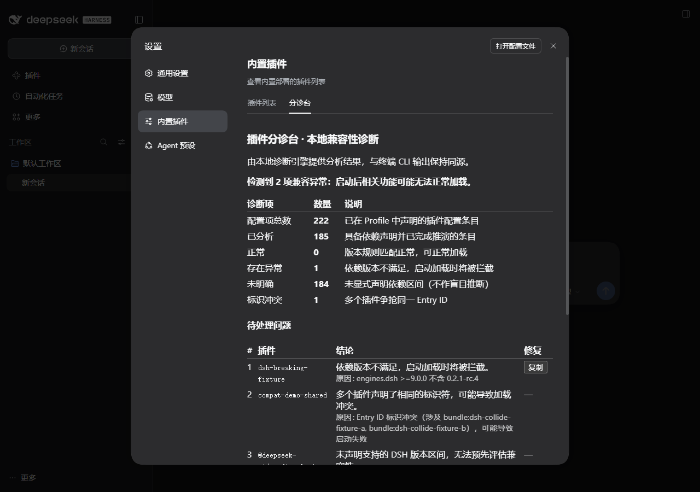
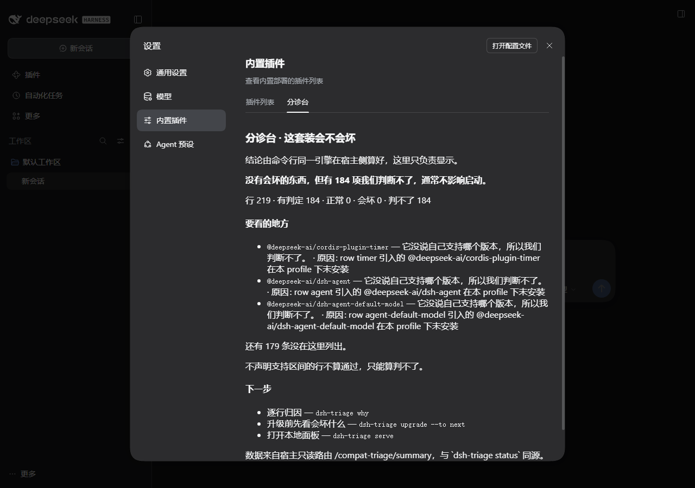

# dsh-triage · 本地插件兼容分诊台

**在「装得上」与「跑得对」之间建立确定性判定层 —— 面向 DeepSeek Harness 插件生态**

[](https://www.npmjs.com/package/dsh-triage)
[](LICENSE)
[](https://nodejs.org)
[](packages/plugin/package.json)
[](scripts/gate.mjs)

[English Overview](#english-overview) | [English README](README.md) | [安全模型 (Security)](docs/SECURITY.md) | [贡献指南 (Contributing)](CONTRIBUTING.md) | [交接说明 (Handoff)](docs/HANDOFF.md)

---

DeepSeek Harness（DSH）原生包管理器负责管理插件能否**成功下载与安装**。然而，安装成功并不代表插件在你的**具体本地环境**中能够正常加载与运行。

`dsh-triage`（分诊台）解决开发者和用户的核心疑问：
- **升级前预检**：每次 DSH 发布新 rc，升级上去当前配置会拦截哪些插件？
- **故障根因归因**：插件装好后为何在界面中静默消失、无报错却无法使用？
- **槽位冲突排查**：多个插件是否在争抢同一 Entry ID 导致启动加载失败？

结论完全基于本地分析，每条判定均绑定可追溯的证据来源；**缺少足够证据时如实判定为 `unknown`（未明确）**，绝不给出生造的模糊评分。

全平台发布于 npm：`dsh-triage@0.3.3` · 独立 CLI + DSH 设置页插件包 · 本地只读 · 仅在主动请求 registry 时进行必要网络通信。

---

## 效果预览

DSH 设置页内置可视化面板（数据来自本地只读接口，与终端 CLI 输出完全同源）：

### 1. 混合场景排查面板（测试夹具构造：版本拦截 + 标识冲突 + 未明确）


> **图 1 说明**：展示捕获多类异常时的视图。明确指出准入版本不满足的具体依赖区间，提供**一键复制修复命令**；精确定位 Entry ID 冲突涉及的具体插件包；对缺少版本声明的插件如实归入“未明确”，不作无证据的假定。

### 2. 真实沙盒环境体检面板（无阻断异常）


> **图 2 说明**：真实干净环境下的体检结果。无阻断或冲突时提示“未检测到兼容性异常或冲突”，视图整洁清晰。

---

## 升级日前瞻预检（Upgrade Day）

上游 DSH 发布每个 rc 版本时，开发者最关心的核心问题是：**我这套已安装的插件组合升上去，会有哪些被拦截？**

<!-- upgrade-card: data/results/upgrade-card-2026-10-31T09-00-00.000Z.json -->
```console
$ dsh-triage upgrade --to next
# 升级日 · 0.2.1-rc.5

**upstream：192 个单元（2 bundle + 190 行）升到 0.2.1-rc.5 → 119 会被拒 · 73 判不了 · 0 会变好 · 0 像没事**

> profile `upstream`（live）· 当前 0.2.1-rc.4 · 目标比当前新
> 判的是**声明层**：只看「声明区间 vs 目标运行时」，不是运行期实测。

| 桶 | 数量 | 意思 |
|---|---|---|
| `would-be-denied` | 119 | 升上去会被摘掉 —— 目标版本的 admission 会拒绝这一行/包 |
| `cannot-tell` | 73 | 判不了 —— 声明不足或目标还没发布，证据不够 |
| `improved` | 0 | 今天被拒、目标放行 —— 今天是坏的，目标版本会放行它 |
| `likely-fine` | 0 | 声明上不冲突 —— 不等于升级后能跑，只表示没有声明冲突 |
```
<!-- /upgrade-card -->

**数据出处**：上述卡片数据基于仓内沙盒 profile（`sandbox/upstream/0.2.1-rc.4`，目标版本 `0.2.1-rc.5`）实跑所得，**不是你的机器**。用户的实际已装插件配置才是推演的输入源。复算验证命令：`node scripts/record_upgrade_card.mjs --stamp 2026-10-31T09-00-00.000Z --to 0.2.1-rc.5`。

- `--to next` / `--to latest` 从 npm `dist-tags` 实时获取目标版本；`--to <版本号>` 全程离线推演。
- `--card --out card.md` 将格式化 Markdown 升级卡片落盘，便于直接附在 GitHub Issue 或 Discussions 中交流。
- 卡片从不承诺“升级后一定可用”：`improved` 项的准确语义是**“目标版本会放行它”**，声明被准入放行不代表运行时动态实测通过。

---

## 为什么需要它（核心痛点）

| 表面现象 | 常见误判 | 实际底层根因 |
|---|---|---|
| 插件安装成功，但界面中没有任何入口 | “插件本身坏了” | 其 `package.json` 未声明 `dsh.bundle`，被作为普通依赖安装，未挂载为 Profile 层 |
| MCP 工具在重启后静默消失 | “MCP 运行不稳定” | Loader 在 **admission（准入评估）** 阶段判定版本不匹配，该行在启动初期被静默剔除 |
| DSH 启动崩溃或完全无法加载 | “整个 Profile 损坏” | 多个插件声明了相同的 Loader Entry ID 或服务名命名冲突，导致启动加载中断 |

DSH 会在运行日志中打印拒绝信息，但在重启或日常运行后日志往往难以寻查。诊断难度的关键在于：
1. **准入评估按 Loader 条目判定，而非按 Bundle 判定**：Bundle 声明正常，引入特定模块的条目仍可能被拒；
2. **声明兼容的模块仍可能加载失败**：存在依赖提升覆盖、标签失步或构建阶段未完成等情况；
3. **未显式声明不等于兼容**：未声明任何版本依赖区间的模块在声明层无法作出确定性判断，需要明确列出。

---

## 上游问题里，这套判断层能覆盖多少

<!-- question-coverage: data/results/question-coverage-2026-11-02T09-57-53-229Z.json -->
**样本**：`deepseek-ai/deepseek-harness` 的 **Q&A 全量 1545 条**（2026-08-13 → 2026-11-02，截止 `#11857`），目标运行时 `0.2.1-rc.5`。**能给出声明层判定：74/1545 = 4.8%（Wilson 95% 3.8–6.0%）**。

| tier | 条数 | 占 Q&A | 意思 |
|---|---:|---:|---|
| `names-a-denial` | 47 | 3.0% | 能点名「这个包会被拒」并给出区间 |
| `rules-out-declaration` | 27 | 1.7% | 能排除声明层（「不是版本区间的问题」） |
| `declares-nothing` | 89 | 5.8% | 只能说明「没声明」——不算兼容，也不算被拒 |
| `upstream-only` | 164 | 10.6% | 只涉及未点名的上游包（npm tag 常年过期），不进头条 |
| `probe-unreadable` | 90 | 5.8% | 名字不是 registry 包（404）或读不到 |
| `needs-their-profile` | 178 | 11.5% | 相关层，但没有可探针的包名 |
| `not-relevant` | 950 | 61.5% | 不是我们的层 |

**上下文（不是头条）**：有层信号的 **595** 条里 **74/595 = 12.4%（Wilson 10.0–15.3%）**；再摘掉读不到的 90 条，是 **74/505 = 14.7%（11.8–18.0%）**。**General 全量 5786 条**另算：**411/5786 = 7.1%（6.5–7.8%）**，投影快照，只作对照，**不与 Q&A 合并**。

**边界**：只对这个样本成立；判的是**已发布 manifest** 对 `0.2.1-rc.5`，**不是你的机器**；分类器只读文本，agent 复核 20 条一致 **9/20**，HUMAN 抽查 **5/5**；未点名的上游包不进头条；`probe-unreadable` 多数是 npm 上没这个名字（404），不是 npm 挂了。

复算：`node scripts/record_question_coverage.mjs --stamp 2026-11-02T10:05:00.000Z --recompute --fixtures data/fixtures/question-coverage/2026-11-02T09-57-53-229Z --target 0.2.1-rc.5`。产物：`data/results/question-coverage-recompute-2026-11-02T10-05-00-000Z.json`；抽检：`data/results/question-review-2026-11-02T10-10-00-000Z.json`；方法：`audit/RECON_2026-11-02_question-coverage.md`。
<!-- /question-coverage -->

---

## 快速安装与使用

### 1. 独立 CLI 工具（推荐日常排查使用，无需常驻后台）

```bash
# 全局安装 CLI
npm install -g dsh-triage

# 升级预检：目标版本会对当前插件组合产生哪些影响？
dsh-triage upgrade --to next --card

# 一键体检：一屏输出当前环境配置状态与异常诊断
dsh-triage status

# 逐行归因：查明插件无法加载或被拦截的准入根因
dsh-triage why

# 全量台账：列出已装插件、声明槽位、工具与服务映射清单
dsh-triage audit

# 本地面板：启动基于本地 HTTP 的轻量可视化分析面板
dsh-triage serve
```

### 2. DSH 设置页集成（内置图形化分析页签）

```bash
# 装入当前 DSH profile
dsh plugin --profile web add dsh-triage
```

安装后在 DSH **“设置页 → 兼容性分析”** 即可直接查看一屏诊断结果与一键复制修复命令。

---

## 常用命令详解

### 1. 查看环境指纹 (`env`)
```console
$ dsh-triage env
dsh        0.1.0-rc.6
node       24.15.0 · win32/x64
profile    web (~/.dsh/profiles/web)
bundles    2
  - @deepseek-ai/dsh-base
  - @deepseek-ai/dsh-web-app
```

### 2. 深入排查静默失效原因 (`why`)
```console
$ dsh-triage why
scanned 2 bundles · 156 loader rows · 128 import targets · dsh 0.1.0-rc.6 · profile web
[UNKNOWN] @deepseek-ai/cordis-plugin-hmr@1.0.16 — 证据不足
  env      dsh 0.1.0-rc.6 · win32/x64 · profile web
  reason   loader row hmr 引入 @deepseek-ai/cordis-plugin-hmr（声明于 bundle:@deepseek-ai/dsh-base）
  reason   row hmr 引入的 @deepseek-ai/cordis-plugin-hmr 没有声明任何 @deepseek-ai/dsh* 区间
  fix      [report] 请作者补上 @deepseek-ai/cordis-plugin-hmr 实际需要的 peer 区间，或做一次隔离实测
  missing  该 row 模块声明的 @deepseek-ai/dsh* peer 区间（或 engines.dsh）
  evidence declared:row, measured-local:runtime
```

### 3. 安装前预先评估候选插件 (`check`)
```console
$ dsh-triage check dsh-cost-meter
[BLOCKED] dsh-cost-meter@1.9.44 — 不可用
  env      dsh 0.1.0-rc.6 · win32/x64 · profile web
  reason   engines.dsh >=0.2.0-rc.1 <0.3.0-0 不含 0.1.0-rc.6
  fix      [allow-version] 为这个精确版本对记录一次显式豁免 -> dsh plugin --profile web allow-version dsh-cost-meter@1.9.44 --dsh-version 0.1.0-rc.6 --accept-risk
  fix      [pin-version] 改装一个声明含 0.1.0-rc.6 的版本（profile: web）
  fix      [upgrade-dsh] 升级 DSH：1 条要求需要更新的运行时（至少 0.2.0-rc.1，当前 0.1.0-rc.6）
  evidence declared:admission, measured-local:runtime, measured-registry:registry-tags
```

### 4. 隔离沙盒环境真机实测 (`probe`)
在独立临时 `DSH_HOME` 中真正执行安装、启动、HTTP 探针与无头浏览器页面挂载，提供动态运行期证据：
```console
$ dsh-triage probe dsh-status-rotator --execute
```
*注：默认模式为 `--dry-run` 仅输出执行方案，明确指定 `--execute` 才会真正拉起沙盒进程，并在退出时自动清理。*

---

## 判定契约与证据模型

分诊台的每项判定均遵循明确严谨的数据结构（Verdict），结论分为四类：

| 结论类别 | 含义 |
|---|---|
| `go` | 静态声明与当前运行时匹配正常；或在 `probe` 实测中安装、启动、响应均正常且条目为 `active` |
| `risky` | 基本可用，但存在明确标记的潜在隐患或限制条件 |
| `blocked` | 存在确定性的阻断项，无法正常加载；**必定提供至少一条可执行的修复命令** |
| `unknown` | 现有声明或证据不足以推演；**必定明确列出缺失的具体信息** |

### 证据等级制度（Evidence Tiers）
每条结论均附带证据链：
- `declared`：插件作者在 `package.json` 等文件中发布的依赖声明；
- `scanned`：对本机已安装文件的静态扫描分析；
- `measured-local`：在当前机器、当前运行时环境下的真实执行观测；
- `measured-registry`：来自官方 npm registry 的公开发布元数据；
- `inferred`：逻辑推导（绝不单独作为输出结论的充要依据）。

---

## 设计边界与不做什么

为保证工具的专注度与安全性，分诊台明确划分了职责边界：

1. **不接管插件生命周期**：不执行安装、卸载、更新或回滚，插件安装卸载由 DSH 原生管理；除隔离沙盒测试外，绝不篡改用户的 `~/.dsh` 配置。
2. **不做集中式市场或排行榜**：仅输出针对当前机器环境的本地诊断结论，不做全网评分或排位。
3. **不提供安全背书**：本工具不提供安全背书。分诊台聚焦于兼容性与启动加载可用性，不代表对插件源码的防恶意软件或供应链安全审计。
4. **不作无证据的猜想**：未显式声明依赖区间的插件严格列入 `unknown`，绝不盲目归入正常。

---

## 严谨可复算的工程证据

本项目所有公开陈述与文档结论均有对应的工程脚本产物支持，全量存储于 `data/results/` 并配备 `.sha256` 校验：

| 验证项 | 复现命令 / 证据源 | 说明 |
|---|---|---|
| 全套自动化验证 | `pnpm run verify` | 构建、类型检查、666 个测试、9 道零依赖门禁 |
| 门禁对抗性负对照 | `node scripts/gate.mjs --mutate` | 校验 9 道门禁均具备真实的拦截捕获能力 |
| 上游准入语义对等 | `data/gold/admission-cases.json` | 27 条人工签署的对等金标基准 |
| 真实故障根因命中 | `node scripts/d1_report.mjs` | 真实案例采集中 9 命中、1 显式 `unknown`（`data/results/d1-*.json`） |
| 发布包真机安装验证 | `data/results/publish-*.json` | 干净环境匿名安装、四包对齐一致性校验 |

---

## 仓库架构概览

```
packages/core/       判断引擎：准入语义、环境指纹、能力台账、Verdict 组装（纯函数、离线）
packages/signals/    信号适配器：npm registry、dsh.so、本地证据适配
packages/probe/      隔离实测：沙盒计划、执行器、无头浏览器 CDP 渲染判定
packages/plugin/     分发入口：dsh-triage CLI、DSH 设置页前端面板、Agent 工具
scripts/             9 道零外部依赖门禁脚本与自动化取证流水线
data/gold/           准入规则人工签署金标基准
data/results/        唯一真相源（SSOT）真实评测 JSON 数据与 .sha256 签名
```

---

## English Overview

**dsh-triage** is the diagnostic layer for DeepSeek Harness (DSH) plugins. It answers why plugins silently disappear after updates and pre-evaluates compatibility risks before upgrading.

### Quick Start
```bash
npm install -g dsh-triage
dsh-triage upgrade --to next --card
dsh-triage status
```

### Safety & Integrity Boundaries
- **Local & Read-only**: Analyzes local configurations without mutating `~/.dsh` files.
- **Explicit Unknowns**: Silence is not a pass. Undeclared ranges yield `unknown` instead of false positives.
- **Security Boundary**: We do **not** provide security assurances — no verdict in this tool means "safe to run" (本工具不提供安全背书).

---

## 参与贡献与交接

欢迎参与完善分诊台！详细指南请参阅：
- [参与贡献指南 (CONTRIBUTING.md)](CONTRIBUTING.md)
- [快速上手与交接文档 (docs/HANDOFF.md)](docs/HANDOFF.md)
- [项目规则与工程约束 (PROJECT_RULES.md)](PROJECT_RULES.md)

---

## 开源许可

本项目基于 [MIT License](LICENSE) 开源。引用自 [dsh.so](https://www.dsh.so) 的注册表事实数据遵循 CC BY 4.0 协议并已在引用处注明。
